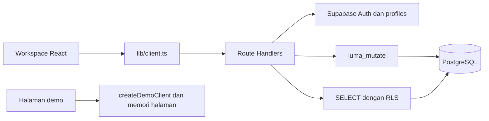

# Arsitektur dan peta kode

Luma Support adalah satu aplikasi server Next.js App Router untuk satu toko. TypeScript memakai mode strict. React menangani antarmuka, Route Handlers menangani API, Supabase Auth memverifikasi pengguna, dan PostgreSQL menyimpan data operasional. CSS global memakai token desain; implementasi sekarang belum memakai CSS Modules seperti rekomendasi awal PRD.

## Alur data

Request nyata membawa cookie HTTP-only. Server memverifikasi token dengan `auth.getUser()`, mencoba refresh bila perlu, lalu memeriksa profil aktif. Read memakai identitas pengguna dan RLS. Write normal memakai `luma_mutate`, sehingga pembaruan tiket dan audit berada dalam satu transaksi database. Secret admin hanya dipakai pada pengiriman undangan.

Mode demo memasok implementasi `api` dan `mutate` dari `createDemoClient` melalui `useMemo` pada workspace. Tampilan dan form dipakai bersama. Adapter demo tidak memanggil endpoint nyata dan tidak menyediakan jaminan konkurensi atau otorisasi produksi.

## Peta kode

| Lokasi | Tanggung jawab |
| --- | --- |
| [app/page.tsx](../app/page.tsx) | Entry workspace dan pemeriksaan konfigurasi |
| [app/demo/page.tsx](../app/demo/page.tsx) | Entry demo dengan data contoh |
| [app/login/page.tsx](../app/login/page.tsx) | Entry autentikasi |
| [app/layout.tsx](../app/layout.tsx) | Bahasa dokumen, metadata, noindex, dan stylesheet |
| [app/globals.css](../app/globals.css) | Token warna, layout desktop/mobile, dialog, dan komponen visual |
| [components/workspace.tsx](../components/workspace.tsx) | Navigasi, daftar, filter, detail, dan seluruh form kerja |
| [components/forms.tsx](../components/forms.tsx) | Modal, form async, empty state, dan label penyimpanan demo |
| [components/login.tsx](../components/login.tsx) | Login, recover, verifikasi tautan, dan form kata sandi |
| [components/icons.tsx](../components/icons.tsx) | Ikon SVG lokal |
| [lib/client.ts](../lib/client.ts) | HTTP client, error, dan pencarian hasil request setelah kegagalan koneksi |
| [lib/server.ts](../lib/server.ts) | Client Supabase server, cookie, identitas, origin, dan pemetaan error |
| [lib/validation.ts](../lib/validation.ts) | Skema Zod untuk body dan query |
| [lib/domain.ts](../lib/domain.ts) | Tipe, label, format tanggal, dan pilihan transisi UI |
| [lib/demo.ts](../lib/demo.ts) | Fixture fiktif, metrik demo, dan mutasi dalam memori |
| [API Auth](../app/api/auth/%5Baction%5D/route.ts) | Login, logout, recover, verify, dan perubahan password |
| [API v1](../app/api/v1/%5B...path%5D/route.ts) | Read dan write workspace |
| [Migrasi](../supabase/migrations/202610280001_luma.sql) | Schema, RLS, transaksi, indeks, dan trigger |
| [tests](../tests) | Pengujian unit dan skrip integrasi database |
| [next.config.ts](../next.config.ts) | Header dasar keamanan dan larangan pengindeksan |

## State, waktu, dan penyimpanan

Filter, halaman, dan draft disimpan di state React. Tidak ada penyimpanan kontak atau draft otomatis ke localStorage. Refresh menghapus state browser; pada workspace nyata, data yang sudah berhasil commit dibaca kembali dari database.

Timestamp API menggunakan ISO 8601; database menyimpan `timestamptz`. Input `datetime-local` dikonversi ke ISO sebelum dikirim. Tampilan tanggal menggunakan locale `id-ID` dan zona waktu browser, bukan zona waktu toko yang dapat diatur. Nomor tiket dan ID event bigint dikirim sebagai string.

Form mempertahankan request ID saat retry dengan isi dan versi sama. Saat terjadi error jaringan atau server, client mencari `/requests/{request_id}` sebelum melaporkan gagal. Tidak ada antrean offline, sinkronisasi background, atau retry tanpa batas.

## Penyajian dan batas akses

Shell UI `/` dapat dimuat anonim; data operasional tetap diambil lewat API yang memerlukan pengguna aktif. Demo `/demo` memang publik dengan fixture fiktif. Jangan menganggap shell halaman, label noindex, atau menyembunyikan tombol sebagai batas keamanan. Otorisasi nyata berada di API, policies, dan fungsi database.

Font Manrope dimuat lewat Google Fonts dari CSS, dengan fallback Arial. Jika jaringan font tidak tersedia, fallback digunakan. Belum ada service worker, upload lampiran, integrasi ekspedisi, pengiriman WhatsApp, atau portal pelanggan.
