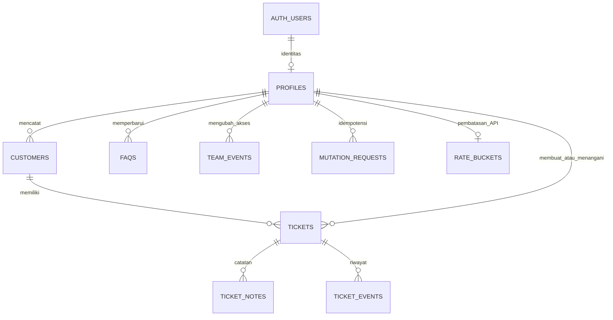

# Database dan transaksi

Sumber schema dan aturan adalah [migrasi awal](../supabase/migrations/202610280001_luma.sql). Migrasi ditujukan untuk PostgreSQL di Supabase karena memakai `auth.users`, `auth.uid()`, serta role `anon` dan `authenticated`.

## Tabel

| Tabel | Isi dan relasi penting |
| --- | --- |
| `profiles` | Identitas Auth, nama tampilan, role admin/agent, dan status aktif |
| `customers` | Nama, referensi kontak, pembuat, dan waktu pencatatan |
| `tickets` | Nomor bigint, pelanggan, subject/summary, kategori, kanal, prioritas, status, owner, creator, version, request hash, serta waktu penerimaan/respons/selesai |
| `ticket_notes` | Catatan append-only milik tiket; author, body, kind, sent_at, dan request hash |
| `ticket_events` | Audit tiket; actor, event_type, details JSON, dan waktu |
| `faqs` | Pertanyaan, jawaban, flag terbit, penulis terakhir, dan waktu pembaruan |
| `team_events` | Audit perubahan role/status profil, mencatat before/after |
| `mutation_requests` | Hasil pertama dan hash payload untuk pasangan actor/request ID |
| `rate_buckets` | Bucket satu menit dengan penghitung request per pengguna |

ID utama umumnya UUID. Nomor tiket dan ID event memakai identity bigint. FK tidak memakai cascade delete; record yang masih dirujuk tidak boleh dihapus begitu saja.

## Constraint penting

Kontak nonkosong unik setelah `lower(trim(contact_reference))`. Tiket memiliki kombinasi unik creator/request ID, notes author/request ID, dan ledger actor/request ID. Request hash memakai SHA-256 atas payload JSONB dan aksi.

Status Ditangani, Menunggu pelanggan, dan Selesai memerlukan owner. Waktu selesai harus terisi tepat saat status Selesai. Note `response` harus mempunyai `sent_at`; note internal/resolution tidak. Transaksi memeriksa owner aktif dan validitas waktu yang tidak cukup diwakili CHECK biasa.

Indeks disediakan untuk antrean status/prioritas/waktu, owner/status/waktu, pelanggan, referensi pesanan nonnull, serta riwayat notes/events. Ukur query aktual di staging sebelum menambah indeks. Pagination tiket dan notes juga memakai UUID sebagai pemecah waktu yang sama; kombinasi pencarian dan cursor masih perlu uji dataset besar.

## Fungsi database

| Fungsi | Kegunaan |
| --- | --- |
| `luma_active()` | Memeriksa apakah `auth.uid()` mempunyai profil aktif |
| `luma_admin()` | Memeriksa admin aktif |
| `luma_rate_limit()` | Menaikkan penghitung dan mengembalikan apakah request API masih diizinkan |
| `luma_mutate(action,payload)` | Jalur transaksi untuk mutasi aplikasi |
| `luma_metrics(days)` | Membaca agregat antrean dan median respons awal |
| `luma_invited_profile()` | Trigger untuk membuat profil agent dari pengguna undangan baru |

Fungsi SECURITY DEFINER menggunakan search path kosong. Aktor transaksi ditetapkan dari `auth.uid()`, bukan field `actor_id` browser. Daftar action terdapat pada [kontrak API](04-api.md).

## Claim, version, dan audit

`luma_mutate` mengunci profil aktor aktif, mengunci request ID dengan advisory lock, lalu mengecek hasil sebelumnya. Untuk tiket yang ada, row tiket dikunci `FOR UPDATE` sebelum owner dan version diperiksa. Claim hanya berlaku untuk tiket Baru tanpa pemilik. Dua claim terhadap baris yang sama harus terserialisasi; pembuktian dua koneksi nyata masih harus dijalankan.

Mutasi tiket menaikkan version dan memperbarui timestamp. Resolution menambahkan note dan event bersama perubahan status. Reopen menghapus `resolved_at` aktif tanpa menghapus histori. Kegagalan insert audit membatalkan transaksi; belum ada pengujian fault injection terhadap kegagalan event di database nyata.

Perubahan tim memakai advisory lock tersendiri untuk menserialisasi pemeriksaan admin terakhir. Penonaktifan tidak otomatis memindahkan tiket. FAQ memakai upsert berdasarkan UUID; belum ada version untuk mencegah dua admin saling menimpa editor FAQ.

## RLS dan grants

Semua sembilan tabel mengaktifkan RLS. `anon` tidak diberi akses tabel. `authenticated` hanya diberi SELECT pada tabel yang dibutuhkan, dengan policy profil aktif. FAQ draft dan team events hanya terbaca admin. Ledger hasil request hanya terbaca aktornya. `rate_buckets` tidak diberi akses baca langsung kepada pengguna aplikasi.

INSERT/UPDATE/DELETE langsung ke tabel tidak diberikan kepada pengguna aplikasi. Mutasi dilakukan lewat fungsi. Pengelola database dan akses service-role memiliki hak khusus; jangan menempatkan key istimewa pada browser.

RLS tidak membuat API Next.js sebagai satu-satunya jalur akses: pengguna dengan JWT dapat memanggil fungsi Supabase yang EXECUTE-nya diberikan kepada `authenticated`. Pemeriksaan role, ownership, version, serta constraint di fungsi tetap penting. Pembatasan rate di Route Handler dan validasi field tidak dikenal oleh Zod tidak otomatis berlaku bagi panggilan RPC langsung. Review permukaan RPC serta uji negatif merupakan pekerjaan sebelum produksi.

## Migrasi dan retensi

Jangan mengubah migrasi awal yang sudah diterapkan pada lingkungan bersama. Tambahkan berkas bertimestamp baru di `supabase/migrations`, uji di staging, dan catat cara pemulihannya. Belum ada migrasi rollback otomatis, scheduler retensi, atau prosedur anonimisasi terimplementasi.

Tidak ada penghapusan permanen tiket, notes, atau events melalui API. Data pelanggan juga dapat tersalin di `mutation_requests.result`; kebijakan retensi dan penghapusan harus memperhitungkan ledger dan backup, bukan hanya tabel customers. Jangan membersihkan ledger tanpa menetapkan masa berlaku retry dan dampak duplikasi request lama.

Pengujian database tersedia di [tests/database.sql](../tests/database.sql). Jalankan di staging yang terisolasi; instruksi ada di [pengujian](07-pengujian.md).
